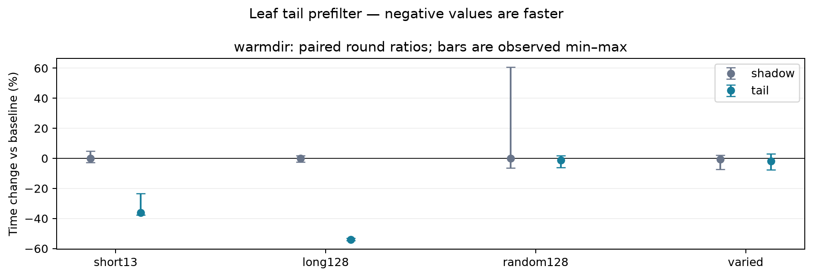
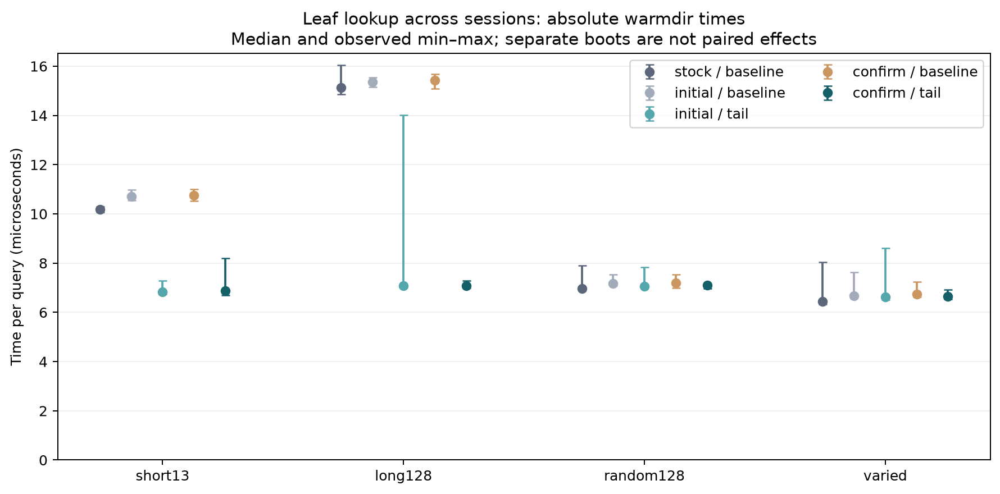
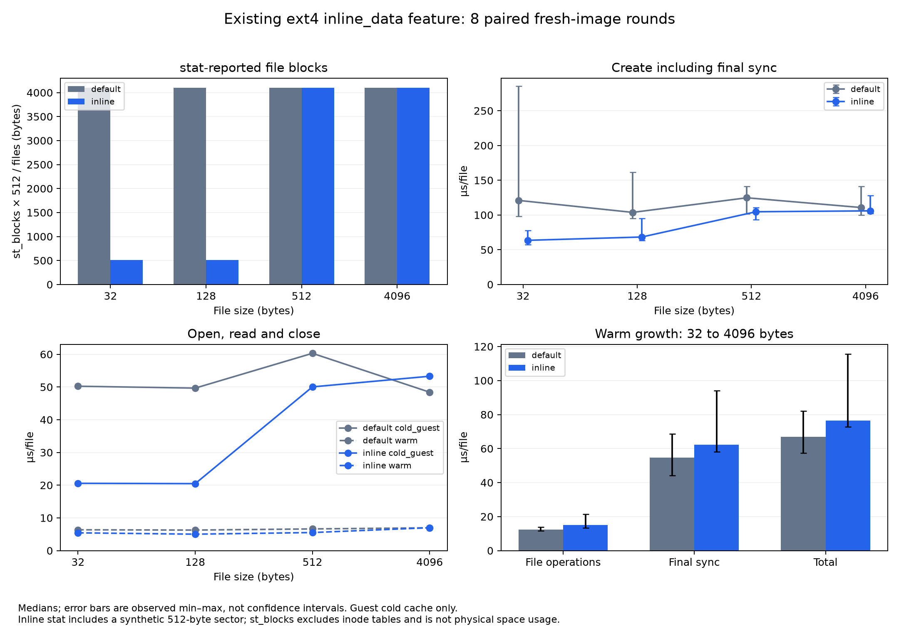

# ext4 추가 개선 후보 실험

Linux 5.4.214에서 기존 HTree 노드 내부 탐색을 바꾸는 대신, **디렉터리 이름 비교**, **extent status의 최근 조회 힌트**, **작은 파일의 inline 저장**을 비교했다. 앞의 두 개는 커널 패치이고, inline_data는 ext4에 이미 있는 기능을 켜고 끈 대조 실험이다.

현재 가장 유망한 후보는 **공통 접두사가 있는 파일 이름의 비교 비용을 줄이는 변경**이다. 번호형 이름과 긴 공통 접두사 조건에서 큰 시간 감소가 별도 부팅에서도 재현됐다. 합성 workload의 결과이며 모든 이름·모든 ext4 작업에서 빨라졌다는 결론은 아니다.

## 독립 확인 결과

아래 변화율은 **같은 round에서 변경 정책/기준 정책 비율을 계산한 뒤 얻은 중앙값**이다. 음수는 시간이 짧아졌다는 뜻이다. 1차 후보 선별과 별도 부팅의 확인 결과를 합치지 않았다.

| 후보 | 확인 조건 | 시간 변화 | 빠른 회차 | 판단 |
|---|---|---:|---:|---|
| 이름 뒤 8바이트 선행 비교 | `file_00000000` 형식, warmdir | **−36.07%** | **20/20** | 유망 |
| 같은 변경 | 120바이트 공통 접두사 + 8자리 ID, warmdir | **−53.96%** | **20/20** | 유망 |
| 같은 변경 | 무작위 128바이트 이름 | −1.26% | 18/20 | 작은 차이; 원본 커널 대비 개선으로 일반화하지 않음 |
| 같은 변경 | 길이가 섞인 이름 | −1.65% | 16/20 | 작은 차이; 큰 prefix 효과와 구분 |
| ES 최근 조회 힌트 갱신 | ES-warm, 같은 extent 반복, SEEK_DATA | **−5.98%** | **20/20** | 메타데이터 조회 조건에서 재현 |
| 같은 변경 | ES-warm, 순차 접근, SEEK_DATA | −5.45% | 20/20 | 같은 extent 안의 반복 조회에 유리 |
| 같은 변경 | ES-warm, 무작위 접근, SEEK_DATA | +0.89% | 3/20 | 개선 없음, 손해 방향 |
| 같은 변경 | 실제 4KiB pread, buffered/O_DIRECT | 조건별 차이가 작고 대조군과 겹침 | — | 파일 읽기 전체 개선은 입증 못함 |
| 기존 inline_data | 32B / 128B 파일, guest cache 정리 후 읽기 | **−59.88% / −54.81%** | 각 8/8 | 기존 저장 방식의 효과 |
| 기존 inline_data | 32B → 4KiB 확장, 마지막 sync 포함 | **+12.93%** | 1/8 | 변환 비용 관측 |

`warmdir`는 guest dcache 정리 뒤 디렉터리 이름만 열거한 조건이다. 물리 디스크 cold가 아니다. 번호형 이름은 zero padding 때문에 앞쪽 바이트가 많이 겹치며, 이 결과를 모든 짧은 이름에 적용할 수 없다. 이미 동일 경로를 조회한 warm 조건은 별도 계측에서 선행 비교 호출이 0이었다.

## 1. 이름 비교

HTree가 선택한 leaf 블록 안에서는 실제 디렉터리 항목과 이름을 비교해야 한다. 이번 빌드의 일반 `memcmp`는 바이트 단위 루프다. 이름의 길이가 같고 8바이트 이상일 때 뒤 8바이트를 먼저 확인하여 다르면 제외하고, 같으면 기존 전체 이름 비교를 수행한다. 끝부분만 같다고 같은 이름으로 처리하지 않는다.

디스크 형식, HTree 구성, 노드 내부 이진 탐색은 유지한다. 암호화·casefold 경로는 기존 비교를 유지하며 별도 실파일 시스템 성능 시험은 하지 않았다. [패치](patches/0002-dirent-tail-prefilter.patch), [memcmp 기계어](results/memcmp-disassembly.txt), [선행 비교 기계어](results/leaf-tail-disassembly.txt)를 함께 볼 수 있다.

50:50 hit/miss 혼합 workload를 나눠 봐도 번호형 이름의 성공 조회와 실패 조회 모두 이득이 있었다. 다만 이 조건부 통계를 100% hit-only/miss-only workload의 결과로 바꾸지는 않는다.

수정하지 않은 B0 커널도 같은 benchmark 바이너리와 이미지로 별도 측정했다. B0의 번호형/긴 접두사 기준 중앙값은 각각 약 10.19/15.14µs였다. 부팅 간 절대값 비교는 아래 그림에 표시하고, 같은 round의 paired 변화율과 구분한다.

## 2. extent status의 최근 조회 힌트

ext4는 ES tree 검색 전에 최근 extent 포인터를 확인한다. 후보는 트리 검색에 성공한 결과를 이 포인터에도 반영한다. 새 자료구조를 만든 것이 아니며, 기존 upstream READ_ONCE/WRITE_ONCE 안전 보정은 두 비교 정책에 공통 적용했다.

ES-warm의 같은 구간 반복에서 20만 질의당 RB 노드 방문 수가 1,800,000 → 9로 줄었다. ES-cold에서는 기존 삽입 경로만으로도 첫 조회 뒤 힌트가 채워져, 같은 구간 반복에서 양쪽 모두 거의 전부 포인터에 적중했다. 이 음성대조에서는 시간 차이도 사실상 없었다.

별도 실제 읽기 시험에서 buffered read는 ES 조회를 호출하지 않았고 O_DIRECT는 질의당 한 번 호출했다. O_DIRECT의 반복 접근에서 트리 방문을 줄여도 전체 pread 시간의 뚜렷한 개선은 입증하지 못했다. SEEK_DATA에서 나온 약 6%를 일반 파일 읽기 속도로 발표하면 안 된다.

[패치](patches/0003-es-lookup-refresh.patch), [메타데이터 결과](analysis/es/es_paired_summary.csv), [실제 읽기 결과](analysis/es-io/es_io_paired_summary.csv).

## 3. inline_data

256바이트 inode·4KiB block의 새 ext4 이미지에서 inline_data 유무만 바꿨다. 32/128B 파일은 실제 inline flag가 전부 켜졌고 512/4096B 파일은 일반 저장 방식이었다.

최종 확인에서 마지막 directory fsync+syncfs를 포함한 생성 시간은 32/128B에서 45.61/33.47% 줄었다. **파일 작업만의 시간**은 각각 −0.47/+4.67%였고, 큰 차이는 마지막 동기화 시간에서 나타났다. 생성 API 자체가 그만큼 빨라졌다고 말하지 않는다.

이 커널은 inline 파일의 `st_blocks`에 512바이트 단위의 보정값을 더한다. 32/128B 파일의 stat 보고량 512B를 별도의 실제 데이터 블록 할당량으로 해석하지 않는다. 생성 시 filesystem free-block 감소량은 파일당 기본 4,128.768B, inline 36.864B였지만 디렉터리 확장을 포함하고 이미지 생성 때 확보된 inode table을 제외한다. 파일 전체 저장비용이나 전체 용량 절감률과 다르다.

32B 파일을 4KiB로 키우면 일반 저장으로 변환되며 추가 데이터 블록과 시간이 필요했다. 변환 후에는 양쪽 모두 inline flag가 꺼져 있으므로 이후 읽기 차이를 inline 직접 저장 효과로 설명하지 않는다. 배치·생성 이력 등의 영향은 별도 분석 대상이다.

## 주제 선택

- **이름 비교:** 기존 디렉터리 lookup 학습과 직접 이어지고, 작은 변경·명확한 입력 조건·재현된 효과를 설명할 수 있어 주제 전환 후보로 우선 검토할 만하다.
- **ES 힌트:** 캐시와 접근 지역성, 부분 최적화가 실제 I/O 속도로 이어지지 않는 이유를 보여주는 보조 후보다.
- **inline_data:** 저장 구조와 변환 비용을 배우기에는 좋지만 기존 기능 비교라는 점을 밝혀야 한다.
- **readahead:** 별도 기존 실험을 유지한다. 여기의 조회 지연과 그 실험의 읽은 양/읽기 대기 시간을 같은 점수처럼 직접 비교하지 않는다.

이 저장소는 팀의 최종 주제를 확정하는 문서가 아니라, 선택할 근거를 제공하는 실험 기록이다.

## 검증과 재현

- 실제 helper에서 추출한 이름 비교: ASan+UBSan 65,535 조건 검사.
- 디렉터리 생성·rename·hardlink·unlink·재생성: 이름, inode, 링크 수, 내용 검증.
- ES: 두 reader 동시 조회, punch-hole·truncate·extend 후 조회 결과 검증.
- 추가 고유 page payload 파일: 두 정책 각각 6단계의 buffered/O_DIRECT 전체 내용 검증.
- 모든 측정의 반환값·내용/checksum·기대 조건 수를 분석기가 검증하고, 모든 실험 이미지의 오프라인 fsck를 통과했다.
- 같은 정책의 shadow 대조군, 별도 프로파일, 원본 B0, 새 부팅·seed 확인을 분리했다.

[실험 계획](docs/plan.md), [재현 방법](docs/reproduce.md), [측정 범위와 주의할 해석](docs/measurement-notes.md), [분석 안내](analysis/README.md), [코드·문서 근거](docs/sources.md).

원자료는 `results/`, 커널 패치는 `patches/`, 사용자 공간 벤치마크는 `bench/`에 있다. 커널 전체 소스·실험 디스크 이미지·접속 정보는 포함하지 않는다. 1차 후보 선별 자료도 삭제하지 않았다. 자세한 결과는 각 분석 CSV에 있다.
